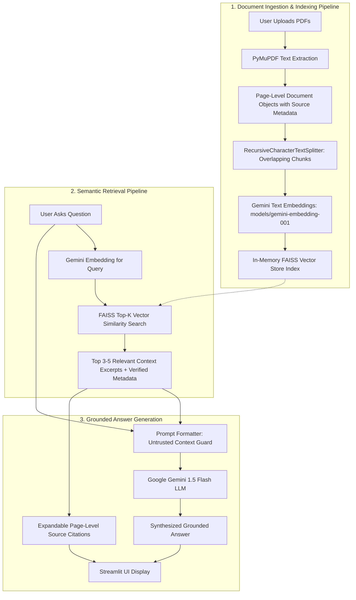

# Document Intelligence Assistant using RAG

> An enterprise-grade, privacy-first Retrieval-Augmented Generation (RAG) assistant that enables users to upload multi-page PDF documents, perform sub-millisecond vector similarity search, and receive factually grounded answers powered by Google Gemini with verified page-level source citations.

---

## 📌 Problem Statement

Enterprise documents—such as contracts, financial disclosures, technical documentation, and compliance policies—are lengthy, unstructured, and time-consuming to review. Standard keyword searches fail to capture semantic intent, while relying purely on generative Large Language Models (LLMs) poses two major enterprise challenges:

1. **Hallucination & Fabrication:** Traditional LLMs may confidently generate inaccurate information when they lack domain-specific or proprietary knowledge.
2. **Auditability & Traceability:** Enterprise decision-makers require transparent source attribution (exact document name and page number) to verify every generated answer before acting on it.

**Document Intelligence Assistant** solves this by implementing an end-to-end RAG architecture that confines generative reasoning strictly to verified passages extracted from uploaded PDFs, eliminating the need to send entire documents into LLM prompts and providing transparent, auditable citations.

---

## 🏗️ Architecture & RAG Workflow

The application follows a modular, decoupled Retrieval-Augmented Generation workflow:



### Detailed Pipeline Stages

1. **In-Memory Text Extraction (`rag/pdf_processor.py`):**
   - Uses **PyMuPDF** (`pymupdf`) to extract text page-by-page directly from byte streams.
   - Prevents storing private enterprise PDFs on disk unnecessarily.
   - Preserves source filename, page number (1-indexed), and total page count in chunk metadata.
   - Gracefully handles encrypted files, empty documents, and scanned image-only PDFs (`NoExtractableTextError`).

2. **Semantic Text Chunking (`rag/pdf_processor.py`):**
   - Chunks text using LangChain's `RecursiveCharacterTextSplitter` (default: 1,000 characters with 150-character overlap).
   - Recursive splitting prioritizes natural linguistic boundaries (`\n\n` $\rightarrow$ `\n` $\rightarrow$ ` ` $\rightarrow$ `""`) to prevent cutting mid-sentence.
   - Attaches unique IDs (`doc_p{page}_c{index}`) to every chunk.

3. **Dense Vector Embeddings (`rag/embeddings.py`):**
   - Converts text chunks into dense continuous vector representations using Google Gemini's `models/gemini-embedding-001`.
   - Captures contextual semantic similarity beyond basic lexical keyword matching.

4. **Vector Search & Session Index Caching (`rag/vector_store.py`):**
   - Indexes embeddings into an in-memory **FAISS** (Facebook AI Similarity Search) index.
   - **Index Caching:** Caches the vector store in Streamlit `session_state`, allowing users to ask multiple consecutive questions without paying the computational and API cost of re-embedding documents.
   - Performs top-$k$ similarity search (typically $k=3$ to $5$) based on cosine distance.

5. **Grounded Synthesis & Prompt Guarding (`rag/qa_pipeline.py`):**
   - Injects retrieved excerpts into an isolated `<context>` block for **Gemini 1.5 Flash**.
   - **Untrusted Context Guard:** Treats document excerpts strictly as passive untrusted data, preventing adversarial documents from executing prompt injections (e.g., instructions like `"Ignore previous instructions"`).
   - **Strict Grounding Directive:** The system prompt explicitly instructs the model to answer **only** from the retrieved excerpts. If the information is not present, the model outputs:
     > *"Based on the provided documents, I could not find information to answer this question."*

6. **Auditable Source Citations (`app.py`):**
   - Citations are generated programmatically from the retrieved `Document` metadata, **not** hallucinated or invented by the LLM.
   - Users can expand each citation in the Streamlit UI to inspect the exact original excerpt.

---

## 💻 Tech Stack

| Component | Technology | Rationale |
| :--- | :--- | :--- |
| **Language** | Python 3.11 | High performance, modern typing, and broad library support |
| **User Interface** | Streamlit | Rapid, reactive UI with session-state caching and interactive widgets |
| **PDF Extraction** | PyMuPDF (`pymupdf`) | High-speed, in-memory PDF parsing with page-level layout awareness |
| **Text Chunking** | LangChain (`RecursiveCharacterTextSplitter`) | Robust multi-delimiter recursive chunking with metadata preservation |
| **Vector Database** | FAISS (`faiss-cpu`) | High-performance, low-latency in-memory vector similarity search |
| **LLM & Embeddings** | Google Gemini (`gemini-3.5-flash-lite`, `models/gemini-embedding-001`) | State-of-the-art reasoning, low latency, and dense vector embeddings |
| **Configuration** | `python-dotenv` | Secure environment variable management; prevents hardcoding secrets |
| **Testing** | `pytest`, `pytest-mock` | Comprehensive unit and integration test coverage with mocked external APIs |

---

## 📁 Project Structure

```text
document-intelligence-rag/
├── app.py                      # Streamlit interactive web application
├── rag/
│   ├── __init__.py             # Package exports
│   ├── pdf_processor.py        # In-memory PDF text extraction & chunking
│   ├── embeddings.py           # Google Gemini embeddings manager
│   ├── vector_store.py         # FAISS vector store creation & search
│   └── qa_pipeline.py          # Grounded QA pipeline & prompt guard
├── tests/
│   ├── __init__.py
│   ├── test_pdf_processor.py   # Unit tests for extraction, edge cases & chunking
│   ├── test_qa_pipeline.py     # Unit tests for QA, citations & FAISS integration
│   └── smoke_test.py           # Optional live Gemini end-to-end smoke test
├── .env.example                # Template for environment variables
├── .gitignore                  # Git exclusion rules (secrets, venv, caches)
├── requirements.txt            # Pinned, tested dependency definitions
└── README.md                   # Complete architectural and setup documentation
```

---

## 🚀 Getting Started

### Prerequisites
- Python 3.11 installed (`python3 --version`)
- A Google Gemini API key ([Get a free key at Google AI Studio](https://aistudio.google.com/app/apikey))

### 1. Clone the Repository
```bash
git clone https://github.com/100Sharma44/document-intelligence-rag.git
cd document-intelligence-rag
```

### 2. Set Up a Virtual Environment
```bash
python3 -m venv .venv
source .venv/bin/activate  # On Windows: .venv\Scripts\activate
```

### 3. Install Dependencies
```bash
pip install --upgrade pip
pip install -r requirements.txt
```

### 4. Configure Google Gemini API Key
Create a `.env` file from the provided `.env.example`:
```bash
cp .env.example .env
```
Open `.env` and set your key:
```env
GOOGLE_API_KEY=AIzaSy...your_actual_key_here
```
> **Security Note:** `.env` is listed in `.gitignore` and will never be tracked or pushed to version control. Alternatively, you can enter your API key directly in the Streamlit sidebar at runtime.

### 5. Launch the Streamlit Application
```bash
streamlit run app.py
```
Open your browser to `http://localhost:8501`.

---

## 🧪 Testing

The test suite covers:
- In-memory PDF text extraction and page metadata preservation.
- Error handling for zero-byte files, non-PDF files, and corrupt documents.
- Scanned/blank PDF handling (`NoExtractableTextError`).
- Metadata-preserving text chunking with overlap.
- FAISS vector store indexing and similarity search using deterministic fake embeddings.
- Grounded QA pipeline synthesis with mocked Gemini responses.
- Handling of API quota limits (HTTP 429) and authentication errors.
- Prompt injection defense against delimiter breakout.
- Programmatic citation verification.

### Run Automated Unit Tests (Offline / No API Key Required)
```bash
source .venv/bin/activate
pytest -v
```

### Run Live End-to-End Smoke Test (Optional, requires `GOOGLE_API_KEY`)
```bash
source .venv/bin/activate
python tests/smoke_test.py
```

---

## 💡 Example Questions

Once you upload and process your PDFs (e.g., an annual report or technical paper), try asking:

1. **Direct Fact Retrieval:**
   > *"What were the total cloud computing revenues reported for FY24?"*
2. **Technical Explanation:**
   > *"How does the system ensure encryption for data in transit and data at rest?"*
3. **Out-of-Scope Query (Testing Grounding & Non-Hallucination):**
   > *"What was the score of the 2026 World Cup final?"*
   >
   > *Expected Model Behavior:* Rather than guessing or introducing external knowledge, the model responds:
   > *"Based on the provided documents, I could not find information to answer this question."*

---


## ⚠️ Known Limitations

1. **Scanned Documents:** Documents without an embedded text layer (e.g. scanned physical paper) require an OCR pre-processing step. Currently, the system detects and flags them gracefully with `NoExtractableTextError`.
2. **Tables and Complex Visual Layouts:** PyMuPDF extracts linear text streams. Complex multi-column financial tables or embedded charts may lose cell alignment unless parsed with a dedicated table parser.
3. **Session In-Memory Scope:** The vector index is cached in memory per user session. Restarting the Streamlit server clears the session state.

---

## 🔮 Future Improvements

- **Hybrid Search (Dense + Sparse):** Combine FAISS dense embeddings with BM25 lexical keyword retrieval for better exact-term matching (e.g., specific part numbers or financial IDs).
- **OCR Integration:** Add an asynchronous OCR pipeline using Google Document AI or Tesseract for scanned receipts and paper scans.
- **Re-Ranking Stage:** Integrate a cross-encoder re-ranker to re-score top-20 retrieved candidates into top-4 high-relevance chunks.
- **Persistent Multi-Tenant Storage:** Connect to Cloud Storage and persistent vector databases (e.g., pgvector or Vertex AI Vector Search).

---

## 📄 Architectural References & Acknowledgements

- Architectural reference & learning inspiration: [RAG-PDF-Chatbot by Ankit Sharma](https://github.com/aankitsharma/RAG-PDF-Chatbot).
- This project is an independent clean-room implementation featuring modern LangChain APIs, PyMuPDF in-memory streaming, prompt-injection defense, verified metadata citation extraction, and FAISS vector caching.

---

## 📜 License

This project is licensed under the [MIT License](LICENSE).
